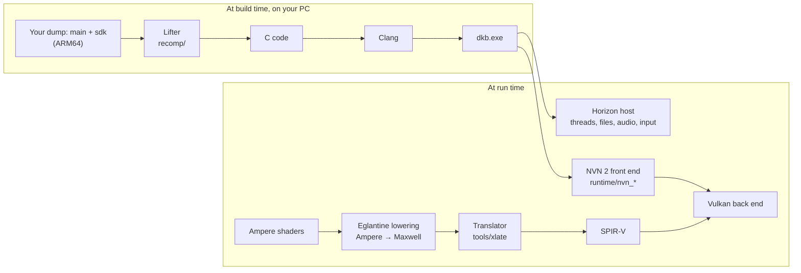

# DKB Recomp

[](LICENSE)
[](https://github.com/Lucas-blip-png/dkb-pc-recomp/actions/workflows/content-guard.yml)
[](https://github.com/Lucas-blip-png/dkb-pc-recomp/stargazers)
[](https://github.com/Lucas-blip-png/dkb-pc-recomp/issues?q=is%3Aopen+label%3A%22help+wanted%22)
[](https://github.com/Lucas-blip-png/dkb-pc-recomp/discussions)
[](https://ko-fi.com/lucasblippng)

**DKB Recomp** is a static recompilation of *Donkey Kong Bananza* (Nintendo Switch 2, 2025) into a native Windows
x86-64 application with a Vulkan renderer. There is no emulator at run time: the game's ARM64 code is translated to C
ahead of time and compiled into one executable, and its graphics calls are answered by a host implementation of
NVN 2. It is built on [TotK Recomp](https://github.com/valentderah/totk-pc-recomp), which does the same for *Tears of
the Kingdom* on the original Switch.

As far as we know, no other static recompilation of a Switch 2 game is public.

> [!IMPORTANT]
> **No game files are included, and none ever will be.** You need your own copy of *Donkey Kong Bananza*, dumped
> from your own console. Instructions for obtaining those files will not be provided. The game itself is never
> downloadable: the [release](https://github.com/Lucas-blip-png/dkb-pc-recomp/releases/latest) carries the installer, and
> everyone builds the game from their own dump.

## Status

**Playable on recent NVIDIA cards, well past the first level.** Players report runs through layer -101, sublayer 200,
the Glacier layer, Snow World (Layer 500) and the Tempest layer. The current release is 0.4.1 (17 November), a smaller one with the 38 pull requests since 0.4.0. The
[latest release](https://github.com/Lucas-blip-png/dkb-pc-recomp/releases/latest) carries an installer that
builds the game from your own dump (`.nup`, `.nx` or folders), and a Linux AppImage: [docs/installer.md](docs/installer.md).
0.4.0 fixes the Snow World and Glacier device loss on NVIDIA (#196, #197, #264), turns the Vulkan recorder off on AMD's
Windows driver (the device loss fix for #84, #124, #142, #155, #167, #176), and guards the guest crashes at the title
screen and on loads (#157, #206), on layer changes (#218) and in a record loop (#229). What still fails:

- GPU hangs under RADV on Linux (#99, #122, #198, #204), and some AMD reports that wait for a retest (#193, #206).
- Guest crashes without a reproduction (#126, #136, #148).
- Intel Arc A770: a driver fault about 20 s in (#3).
- Missing effects in the Tempest layer (#221): a player reports the tornado draws on `bananza`; retest asked.
- Heavy scenes below 60 fps (#141, #156). Since 0.4.0 new defaults raise our heavy test scene
  from about 53 to 58 fps and halve the frames over 25 ms; a stall of about 0.45 s on area loads is left. See
  [docs/dkb-lowend.md](docs/dkb-lowend.md).
- A soft 3D picture: the game's dynamic resolution draws the scene at 2/3 of the output (1280x720 at 1080p, #210).
  On `bananza` (9190e6b), `scene_res = full` draws it at the output size.
- Add-on content: the installer unpacks DLC from a `.nup` (57eaed9); a player confirmed the DLC and the 3.2.0
  update load (#183). Loose RomFS mods load from a `mods` folder beside `dkb.exe` (7779dda).

Since 0.4.0 (in 0.4.1): FSR 3.1 and FSR 4 temporal upscalers (`upscaler = fsr3` or `fsr4`, #270), DLSS and
both FSR upscalers as native anti-aliasing on 3.2.0 when `scene_res = full`, frame generation with an Auto mode,
3x to 8x and AMD's FSR 3.1 frame interpolation (`frame_gen_by = fsr3`), optional CRT filters (`crt_filter`) and
window scaling filters (`window_filter`), sharper text above 1080p behind `DKB_FONT_SCALE=1` (#214), Polish
(`lang = pl`, #335), evenly paced audio (#133), HD rumble on Switch Pro Controllers and Joy-Con (#285, untested),
the AppImage setup fix (#293) and the setup check on CPUs without AVX2 (#318). The CRT and window filters and the
FSR 3.1 frame interpolation come from community pull requests and have had little testing in play. On `bananza` since 0.4.1: HD rumble is off by default (`rumble_hd = auto` turns it on; third-party pads broke with it, #363, #383) and falls back to two motors for the session
after a pad drops (#363), and fewer lock waits and scans in the replay (#354, #361, #365). The Landfill Layer device loss
on NVIDIA 50-series (#304) is avoided by skipping one vertex stage (45e1a6f48cb7872e), `console = 0` works with Windows
Terminal (#238), and 23 more community pull requests landed (samplers, Linux memory and lazy write-back, GPU write bookkeeping, fewer VirtualQuery calls, HDR screenshots, DLSS warm-up). The smash blur ends above 60 fps on 1.0.0 too (#389, #390), and DLC from a container whose base package has title id 0 installs (#388).

RecompLauncher on Linux and macOS: [docs/recomp-launcher.md](docs/recomp-launcher.md). Progress, day by day: [docs/devlog.md](docs/devlog.md). Last updated: 18 November 2026.

| Phase | | State |
| --- | --- | --- |
| F0 CPU | ✅ | `main` and `sdk` (180,061 functions) lift with no unsupported instruction (ARMv8.3 pointer authentication and `LDAPR` added). Differential tests against Unicorn pass. |
| F1 OS | ✅ | Boots on TotK Recomp's Horizon host with the Switch 2 differences: RomFS, save, audio, controller. |
| F2 NVN 2 | ✅ | 700 NVN 2 entry points answered; the game loop runs. 51 new command buffer calls (mesh shaders, VRS, DLSS, push constants…) are accepted but not recorded yet. |
| F3 Shaders | ✅ | All 4,820 Ampere shader stages of the first 3D scene go through Eglantine's Ampere-to-Maxwell lowering and TotK Recomp's translator to SPIR-V. |
| F4 Vulkan | ✅ | The title screen and the tutorial's 3D scene render. |
| F5 Playable | ✅ | Controller, guide movies (VP9), push constants, installer and releases 0.1.0 to 0.4.0. |
| F6 Stability | 🚧 | Device lost on NVIDIA and AMD, RADV hangs and guest crashes in later areas. |
| F7 Performance | 🚧 | A heavy scene runs at about 58 fps on `bananza`, with a stall of about 0.45 s on area loads. |
| F8 Image | 🚧 | Missing effects, some textures and terrain details. |
| F9 Platforms | 🚧 | Linux and macOS preview packages, RecompLauncher, audio and DLC. |

The plan, phase by phase: [docs/bananza-plan.md](docs/bananza-plan.md). What is open right now:
[Roadmap to playable](https://github.com/Lucas-blip-png/dkb-pc-recomp/issues/10).

## How it works



The longer version is in [docs/architecture.md](docs/architecture.md) (shared with TotK Recomp) and
[docs/bananza-shaders.md](docs/bananza-shaders.md) (the NVN 2 shader work).

## How to help

Each open problem is a separate, well-bounded job with its own issue. Pick one, say in the issue that you are on it,
and keep each pull request to one topic. Issues labelled
[`in progress`](https://github.com/Lucas-blip-png/dkb-pc-recomp/issues?q=is%3Aopen+label%3A%22in+progress%22) are
already taken, and the top of the [roadmap](https://github.com/Lucas-blip-png/dkb-pc-recomp/issues/10) says what is
being worked on right now.

**No code needed**, only your PC and your own copy of the game:

- [#3](https://github.com/Lucas-blip-png/dkb-pc-recomp/issues/3) **Test on your GPU.** Everything so far was checked
  on one NVIDIA card. Runs on AMD, Intel and other NVIDIA cards, with logs, show what breaks there.
- **Play as far as you can** and report where it stops, with the crash form.
- [#9](https://github.com/Lucas-blip-png/dkb-pc-recomp/issues/9) **The GPU fault after the first guide movie**: seen
  on three NVIDIA drivers (617.14, 617.42, 621.01); runs on AMD and Intel would show whether it is NVIDIA's.

**Code** ([help wanted](https://github.com/Lucas-blip-png/dkb-pc-recomp/issues?q=is%3Aopen+label%3A%22help+wanted%22)):

- [#5](https://github.com/Lucas-blip-png/dkb-pc-recomp/issues/5) **Checkerboard textures** on some rock surfaces. The Switch 2 GOB layout (f4f7b17) fixes the gold rock in the tutorial cave; the other surfaces still need a check.
- [#6](https://github.com/Lucas-blip-png/dkb-pc-recomp/issues/6) **NVN 2 calls not recorded yet**: mesh shaders, VRS,
  DLSS and others.
- **Symbols.** Function names help debugging. They come from
  [GRAnimated/DKBananza](https://github.com/GRAnimated/DKBananza), which welcomes contributions too.

Your first contribution, step by step:

1. Build from your own dump ([Building from source](#building-from-source)).
2. Run it as in [docs/dkb-testing.md](docs/dkb-testing.md) and note how far it gets on your machine.
3. Report it on #3 or #7, or pick an issue above.

Before you open a pull request, read [CONTRIBUTING.md](CONTRIBUTING.md). Its hard rule: nothing that came out of the
game goes into the repository, not in commits, issues or pull requests. Run `python tools/check_content.py --staged`
before committing; CI runs the same check. Questions go to
[Discussions](https://github.com/Lucas-blip-png/dkb-pc-recomp/discussions). Everyone taking part follows the
[code of conduct](CODE_OF_CONDUCT.md).

## Support the project

If you want to support the work without writing code, tips go to
[ko-fi.com/lucasblippng](https://ko-fi.com/lucasblippng). A tip pays for time on the project; it buys no game files,
builds or early access, and everything stays open source here. Starring the repository and sharing it with people who
know GPUs, ARM64 or the Switch also helps.

## Building from source

The toolchain is TotK Recomp's ([docs/building.md](docs/building.md)): MSYS2 UCRT64 Clang, Ninja, Python 3.12 and the
.NET SDK for the shader translator. With the Bananza ExeFS and RomFS from your own dump:

```
.venv\Scripts\python tools\build_xlate.py
.venv\Scripts\python recomp\gen.py --exefs <exefs> --out generated\dkb100 --modules main,sdk --patches recomp\patches-dkb100.txt
.venv\Scripts\python tools\dkb_expected.py --exefs <exefs> --name dkb100 --display 1.0.0
.venv\Scripts\python tools\dkb_pack_romfs.py --dir <romfs folder> --out build\extracted\dkb100\romfs
.venv\Scripts\python tools\build_game.py --version dkb100 --expected tools\data\expected-dkb100.json --exefs <exefs> --romfs build\extracted\dkb100\romfs
```

Everything the build writes stays under `build\` and `generated\`, which git ignores. The game commits about 14 GB (13.5 GiB at the start and
13.75 GiB after 40 minutes, rising about 6 MB per minute; longer sessions are untested), so 16 GB of RAM plus a large page file is the minimum for now and 32 GB is comfortable. Running and testing: [docs/dkb-testing.md](docs/dkb-testing.md).

## FAQ

**Can I play it?** Partly. One hand-played run went from the title screen through the tutorial, its cutscene and the
first stage to its end on an RTX 5060 Ti, with drops while a new area loads; other cards are untested and it can still
crash. Follow the
[roadmap](https://github.com/Lucas-blip-png/dkb-pc-recomp/issues/10) or the [devlog](docs/devlog.md).

**Is there a download?** Of the installer, on the [release page](https://github.com/Lucas-blip-png/dkb-pc-recomp/releases/latest).
The executable is made from the game's own code, so it cannot be shared. Everyone builds it from their own dump; the
installer does this for you ([docs/installer.md](docs/installer.md)).

**Which version of the game?** Base 1.0.0 and update 3.2.0 (title version 458752, the newest). The installer takes either a `.nup` file (the container Eglantine and Eden load; with the 3.2.0 update inside it builds 3.2.0) or ExeFS and RomFS folders. Other updates are refused by their hashes. The 3.2.0 build installs and boots, and holds 60 fps for 150 s at the start on an RTX 5060 Ti, but nobody has played it yet. Add-on content (DLC) has a reader (an `aoc-<n>` folder beside the executable, [docs/dkb-testing.md](docs/dkb-testing.md)) checked against synthetic packs and a real one, but it has not been tried in the game.

**Linux?** Preview. The release page carries `DKB-Setup-<version>-linux-x86_64.tar.gz`: the sources and a setup script, not a
binary. You install the system packages and it builds the game from your dump. The build from source is verified on AMD
and NVIDIA GPUs ([docs/installer.md](docs/installer.md), "Bananza Linux and macOS packages").

**macOS?** Preview. `DKB-Setup-<version>-macos-arm64.zip` is the same kind of package. It builds and boots on Apple
Silicon with MoltenVK: the game reaches the mode select ([docs/building.md](docs/building.md), "macOS"). It is not
verified beyond that, and the destructible terrain is missing until the geometry stages have a vertex-stage replacement.

**Why GPL?** The shader lowering comes from Eglantine (Eden Emulator Project), which is GPL. Files that came from TotK
Recomp keep their MIT terms.

**How is AI used?** Most of the code and documentation is written by AI coding agents (Claude Code), as in TotK
Recomp, and checked by running the game and the differential tests. AI-assisted pull requests are welcome; you are
responsible for having read and run them.

## Credits and origin

DKB Recomp is built on [TotK Recomp](https://github.com/valentderah/totk-pc-recomp) (*Tears of the Kingdom*, Switch 1)
by valentderah and its contributors (MIT, kept in [LICENSE-MIT](LICENSE-MIT)). It uses Eglantine's Ampere shader
lowering (GPL-3.0-or-later, `runtime/third_party/eglantine/`) and Ryujinx's shader translator (MIT, vendored with
MacNativeGames' patches), plus the other projects in [THIRD_PARTY_NOTICES.md](THIRD_PARTY_NOTICES.md). The whole is
under [LICENSE](LICENSE).

- [TotK Recomp](https://github.com/valentderah/totk-pc-recomp) by valentderah, the base of everything here, and the
  projects it builds on: [LAS Recomp](https://github.com/peiikai/LASRecomp),
  [MacNativeGames](https://github.com/ly05010419/MacNativeGames), [nxnative](https://github.com/seedds/nxnative),
  [SavageWindRecomp](https://github.com/Revivedx/SavageWindRecomp), [Ryujinx](https://github.com/Ryujinx/Ryujinx),
  [deko3d](https://github.com/devkitPro/deko3d), [hactool](https://github.com/SciresM/hactool) and the rest listed in
  [THIRD_PARTY_NOTICES.md](THIRD_PARTY_NOTICES.md).
- [GRAnimated/DKBananza](https://github.com/GRAnimated/DKBananza) for the game's symbols and research.
- [Eglantine](https://git.eden-emu.dev/Franseven/PokeDinner-a-Eglantine-Fork) (Eden Emulator Project) for the
  Ampere-to-Maxwell shader lowering and its Switch 2 notes, and [Mesa NAK](https://gitlab.freedesktop.org/mesa/mesa)
  for the SM70+ encodings both build on.
- [libvpx](https://chromium.googlesource.com/webm/libvpx) for the movies.
- [Switchbrew](https://switchbrew.org) for the Switch 2 `GetInfo` ids, and the Switch homebrew community.

## License

DKB Recomp as a whole is under the [GNU GPL v3 or later](LICENSE), because it includes Eglantine's GPL Ampere shader
lowering (`runtime/third_party/eglantine/`). The files that came from TotK Recomp keep their
[MIT License](LICENSE-MIT); third-party code keeps its own license ([THIRD_PARTY_NOTICES.md](THIRD_PARTY_NOTICES.md)).
The license grants nothing for Nintendo's game.

DKB Recomp is an independent, non-commercial fan project, not affiliated with or endorsed by Nintendo. *Donkey Kong
Bananza* and *Nintendo Switch 2* are trademarks of Nintendo.
